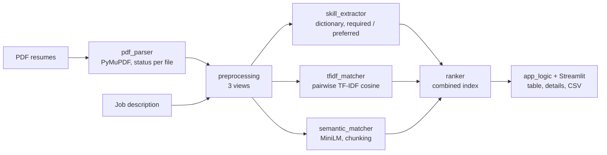
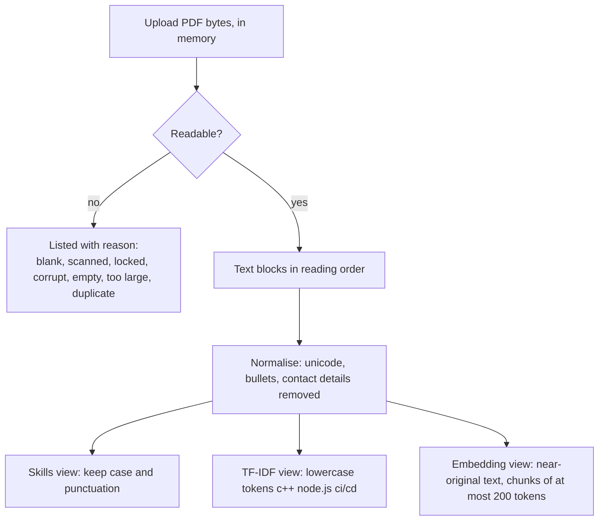

# Presentation outline (12 slides, about 12 to 14 minutes)

**Phase 13 update:** the deck now exists: `presentation/Resume_Screening_Project.pptx` (12 editable slides, speaker notes on every
slide, built by `presentation/build_deck.js`). This outline is the plan it follows; where the two differ, the deck and its speaker notes are
newer (for example the deck uses crops of two real screenshots, and the presenter name, guide and institution are intentionally left off
slide 1 for you to add). The visuals that were "TO DRAW" / "TO CAPTURE" below now exist; see the updated table. The Mermaid sketches are kept
only as a record; the diagrams actually used are `docs/figures/diagram_architecture.svg` and `diagram_pipeline.svg`.

Every number is in `EXPERIMENT_RESULTS.md` or the stored artifacts. Do not add a number, screenshot or claim that is not listed in the repository.

**Rules for the whole deck**
- Say "synthetic" every time results appear (46 invented resumes, 5 invented jobs).
- Never write "accurate", "best", "probability", "production-ready", "reads scanned resumes" or "private/secure" without qualification.
- The app has **three selectable methods: TF-IDF, semantic, combined**. Skill coverage is a **component** of the combined index, not a fourth mode.
- Keep slides light: at most 5 bullets and one visual; put equations on the slide, details in the notes.

**Visuals status**
| Visual | Status |
|---|---|
| Architecture diagram | EXISTS: `docs/figures/diagram_architecture.svg` (source `make_diagrams.py`) |
| Resume-processing pipeline | EXISTS: `docs/figures/diagram_pipeline.svg` |
| TF-IDF vs semantic matching illustration | built on the slides as shapes (labelled as an illustration, not data) |
| Combined-score calculation | formula card plus a crop of the real candidate-details screenshot (slide 9) |
| Evaluation comparison chart | EXISTS: `docs/figures/fig_evaluation_macro.svg` and `fig_ndcg_per_job.svg` |
| Skill-coverage influence chart | EXISTS: `docs/figures/fig_component_influence.svg` |
| Application screenshots (12) | 9 captured from the running app (items 1 to 9, two files for items 4 and 9); items 10 to 12 are pictures rendered from real captured text; real window screenshots of those three remain manual: `docs/SCREENSHOT_CHECKLIST.md` |

**Mermaid sources (draw these by hand in the slide tool, or paste into a Mermaid renderer)**

---

## Slide 1. Title and introduction
- **Main message:** a transparent resume-ranking assistant that compares traditional and semantic text matching.
- **Bullets:** project title; your name, guide, institution; "decision support, not hiring decisions"; the three methods in one line; "all demo data are synthetic".
- **Visual:** the application home screen (**TO CAPTURE**, screenshot 1).
- **Technical details:** none on this slide.
- **Speaker notes:** introduce yourself and the one-sentence description from the viva guide. State the framing early: a person reviews every candidate.
- **Likely questions:** "Is this fully automated hiring?" No. "What is new here?" Do not claim novelty; the contribution is an integrated, tested, honestly evaluated comparison (see `docs/RELATED_WORK.md`, section 7).

## Slide 2. Problem statement and motivation
- **Main message:** reading many resumes is slow and inconsistent; keyword search misses meaning and rewards keyword stuffing.
- **Bullets:** one vacancy, many PDF resumes; keyword matching fails on synonyms ("sklearn" vs "scikit-learn"); embeddings relate meanings but can rate unrelated or negated text as similar; recruiters need to see *why* a candidate ranks where they do.
- **Visual:** a two-row example (hand-made, synthetic): "Python developer" vs "programmer experienced in Python scripting" (no shared keywords besides Python) with TF-IDF vs semantic behaviour described in words, not invented scores. Or leave as text.
- **Technical details:** none.
- **Speaker notes:** the motivation is a design motivation, not a claimed research gap: show the measured examples later (slide 10).
- **Likely questions:** "Why not just use an LLM?" Privacy, cost, explainability and reproducibility; trade-off is weaker understanding of context. "Who would use it?" Recruiters or placement cells; not validated for real use.

## Slide 3. Objectives and scope
- **Main message:** a clear, bounded project.
- **Bullets:** extract text safely from PDFs; extract skills transparently; score with TF-IDF, semantic similarity and a combined index; evaluate fairly; Streamlit interface with CSV export. **Out of scope:** OCR, LLMs, fine-tuning, databases, login, deployment.
- **Visual:** none, or a simple in/out-of-scope two-column table.
- **Technical details:** nothing is trained: TF-IDF fitting only counts words; the embedding model is pretrained and used as published.
- **Speaker notes:** say the exclusions out loud; they are decisions, not omissions.
- **Likely questions:** "Did you train a model?" No. "Why no OCR?" Scope and risk; scanned files are detected and reported.

## Slide 4. Related work and research foundation
- **Main message:** the techniques are established; the project combines and tests them, and claims nothing beyond that.
- **Bullets:** TF-IDF / IDF (Spärck Jones 1972; Salton and Buckley 1988); Sentence-BERT (Reimers and Gurevych 2019) and MiniLM (Wang et al. 2020), model card for all-MiniLM-L6-v2; hybrid lexical + dense ranking (Karpukhin et al. 2020; BEIR 2021); explicit skills with embeddings in job matching (Gugnani and Misra 2020); fairness and regulation context (Raghavan et al. 2020; Bolukbasi et al. 2016; EU AI Act Service Desk).
- **Visual:** a compact table "Work | what it addresses | how this project relates" from `docs/RELATED_WORK.md`.
- **Technical details:** DPR's hybrid score `BM25 + λ·sim` with λ tuned on a development set vs this project's weights fixed in advance.
- **Speaker notes:** "reviewed, not implemented" for every paper except the standard TF-IDF idea and the published embedding model. Say that this is a small, non-systematic review.
- **Likely questions:** "Which paper did you implement?" None; TF-IDF via scikit-learn and a published model via sentence-transformers. "Is the combination novel?" I did not find the exact combination in my small search; that is not evidence it is new.

## Slide 5. System architecture
- **Main message:** modular pipeline; the interface contains no matching algorithm.
- **Bullets:** parser, preprocessing, skill extractor, TF-IDF matcher, semantic matcher, ranker, app logic, Streamlit; each module tested; data stay in memory.
- **Visual:** the architecture diagram (**TO DRAW**, first Mermaid source).
- **Technical details:** stack: Python 3.12, PyMuPDF, scikit-learn, sentence-transformers (`sentence-transformers/all-MiniLM-L6-v2`, CPU), Streamlit, pytest.
- **Speaker notes:** a test checks that `app.py` and `app_logic.py` import no sklearn, numpy or model libraries.
- **Likely questions:** "Why separate `app_logic.py`?" Testability without a browser. "Why these libraries?" See viva guide section 4.

## Slide 6. End-to-end workflow and PDF processing
- **Main message:** every file gets a status; a bad file never stops the others and is never treated as an empty resume.
- **Bullets:** PyMuPDF text blocks in reading order; statuses: readable, no usable text, probably scanned (OCR needed), password-protected, corrupted, empty, too large, duplicate (SHA-256 of bytes); three preprocessing views (skills / TF-IDF / embeddings); contact details removed.
- **Visual:** the pipeline diagram (**TO DRAW**, second Mermaid source) and the validation table screenshot (**TO CAPTURE**, screenshot 4).
- **Technical details:** thresholds: fewer than 100 readable characters = unusable; scanned heuristic = image page with under 20 characters; parser size limit 10 MB; Streamlit cap 25 MB.
- **Speaker notes:** the scanned fixture is a generated image-only PDF; OCR is not implemented; duplicate detection only catches identical bytes.
- **Likely questions:** "How do you know a file is scanned?" Heuristic, not proof. "What if the same resume is saved again from Word?" Not detected as a duplicate.

## Slide 7. TF-IDF and cosine similarity
- **Main message:** a traditional, transparent baseline that measures word overlap.
- **Bullets:** tf = 1 + ln(count); idf = ln((1+n)/(1+df)) + 1; vectors L2-normalised; cosine = dot product, range 0 to 1; custom tokens keep `c++`, `c#`, `.net`, `node.js`, `ci/cd`; fitted per job/resume pair so one resume's score never depends on the others.
- **Visual:** the formulas and a two-document worked example: "python sql" vs "python docker" gives cosine 0.336 (hand-calculated and a unit test; this is the single-word version, the app also uses word pairs, which changes the number).
- **Technical details:** `ngram_range=(1,2)`, `lowercase=False`, `token_pattern=\S+`; with two documents IDF is nearly flat (1.0 or 1.405).
- **Speaker notes:** pairwise fitting was chosen after measuring a score change from 0.2553 (batch of 10) to 0.2134 (alone); the cost is a weak IDF.
- **Likely questions:** "Why not a reference corpus?" None available; an option for future work. "Why cosine?" Length-insensitive.

## Slide 8. Transformer-based semantic similarity and the selected model
- **Main message:** a pretrained model maps text to vectors whose cosine reflects closeness of meaning, not possession of a skill.
- **Bullets:** `sentence-transformers/all-MiniLM-L6-v2`: 384 dimensions; truncates beyond 256 word pieces (measured here and on the model card); used as published, not trained by us; long texts split into chunks (at most 200 tokens, up to 40 overlap); score = job-chunk-weighted mean of the best resume-chunk cosine; raw cosine, not a percentage.
- **Visual:** **TO DRAW** a simple picture: three short texts as points in a plane, with arrows showing that "sklearn model" and "scikit-learn" are close while a pastry-chef sentence is far (label it "illustration, not data").
- **Technical details:** model card: fine-tuned from a MiniLM base on more than 1 billion sentence pairs, trained with sequence length 128, Apache-2.0; project example: skills on the last page: 0.034 truncated vs 0.302 chunked (one constructed case).
- **Speaker notes:** the model does not understand negation (it scored "no experience with Python or SQL" at 0.376 against a backend job in a small check); one chunk can decide the score when the job description fits in one chunk.
- **Likely questions:** "Is 0.7 a 70% match?" No. "Why chunk size 200?" Margin under 254 usable tokens; the model was trained with 128-token sequences and the effect of that was not evaluated.

## Slide 9. Combined ranking formula and score interpretation
- **Main message:** a transparent weighted index for ordering candidates, not a probability.
- **Bullets:** `index = 0.50 × max(0, semantic) + 0.20 × TF-IDF + 0.30 × required-skill coverage`; coverage = matched required skills / required skills (unique canonical skills); weights fixed before evaluation, never tuned; if coverage is unavailable the other weights are renormalised (0.50/0.70 and 0.20/0.70) and the app warns; scores are text-matching values.
- **Visual:** the formula with one real worked row from a run you capture (**TO CAPTURE**, screenshot 8) or the three-column table with component values.
- **Technical details:** skill extraction = dictionary of 114 skills, aliases, boundary regexes, context rules, longest match; required vs preferred from headings and cue phrases.
- **Speaker notes:** the combined index orders candidates; the three components are on different scales, so the weights are not equal-influence (next slides).
- **Likely questions:** "Where do the weights come from?" Initial design choices, not optimal. "What if the job description lists no skills?" Coverage blank, other weights renormalised, warning shown.

## Slide 10. Experimental methodology, results and critical findings
- **Main message:** on a small synthetic set the combined index beat TF-IDF but did not clearly beat semantic similarity alone; skill coverage dominates the combined index.
- **Bullets:** protocol written first; 5 invented jobs, 46 invented resumes; labels 0-3 from a rubric, frozen with hashes; relevant = label 2 or 3; K = 3; macro average; results table below; keyword lists fooled TF-IDF; negation and "describes the role from outside" fooled the semantic score; coverage missed paraphrase and counted mentions; coverage drives about 75% of the index's variance.

| Method | Precision@3 | Recall@3 | MRR | nDCG@3 |
|---|---:|---:|---:|---:|
| TF-IDF | 0.467 | 0.300 | 0.567 | 0.461 |
| Semantic | 0.600 | 0.390 | 1.000 | 0.651 |
| Combined | 0.600 | 0.390 | 0.900 | 0.654 |

- **Visual:** `docs/figures/fig_evaluation_macro.svg`, `fig_ndcg_per_job.svg`, `fig_component_influence.svg` (put the table or the macro chart on the slide and the others on a backup slide).
- **Technical details:** nDCG gain 2^label − 1, discount 1/log2(position+1); Recall@3 capped at 0.6 to 0.75 by 4 to 5 relevant resumes per job; per job on nDCG the combined index was better on 2 jobs and worse on 3; the evaluation re-run was byte-identical.
- **Speaker notes:** read the caveats: same author wrote system, data and labels; one annotator; 5 jobs; no significance claim; the skill-coverage influence is descriptive (std. dev. 0.346 vs 0.089 vs 0.051; Pearson r with the index 0.93 / 0.59 / 0.67) and does not prove better or worse ranking. Exploratory ablations were looked at after the main result and are not used to choose settings.
- **Likely questions:** "So is combined better?" Better than TF-IDF here; not shown better than semantic. "Why is semantic MRR 1.000?" A relevant resume was first in every job; its Precision@3 is 0.600. "Is the difference significant?" No claim; too few jobs. "Why does coverage dominate?" Widest spread, terms added without rescaling.

## Slide 11. Security, privacy, limitations and responsible use
- **Main message:** honest limits and a defensible safety posture.
- **Bullets:** in memory only, no files written and no resume text logged by project code (tested); localhost only, telemetry off; no networking library in project code; model download/update check contacts Hugging Face unless `HF_HUB_OFFLINE=1`; CSV formula-injection protection; markdown-rendering vulnerability found in Phase 10 and fixed (escaped file names and snippets, regression test); limits: no OCR, English only, dictionary skills (no negation or role understanding), synthetic evaluation, no real-resume testing; human review of every candidate.
- **Visual:** a "tested / not tested" two-column table from `docs/PROJECT_READINESS_REPORT.md`; optionally the CSV screenshot (**TO CAPTURE**, screenshot 9) and the offline-run screenshot (**TO CAPTURE**, screenshot 10).
- **Technical details:** cache keys contain file bytes, job description, method and configuration signature; data caches per browser session, at most 8 entries, one hour; names and other personal data (apart from e-mail, phone, URLs) remain in the text; no fairness audit was done.
- **Speaker notes:** do not say "secure" or "private" without qualification; say what was tested. 389 passing tests show behaviour, not ranking accuracy.
- **Likely questions:** "What was the vulnerability?" Untrusted text shown as markdown could display links or formatting chosen by the resume's author. "Does it comply with the EU AI Act?" No compliance claim; it is an unreleased student project and ranking tools for recruitment can be high-risk. "Why does a passing test suite not prove accuracy?" See viva guide Q58.

## Slide 12. Conclusion, future work and references
- **Main message:** a working, documented, honestly evaluated prototype; the evidence for the combined index is limited.
- **Bullets:** delivered: parser, three methods, interface, CSV, tests (389 passed), reproducible synthetic evaluation, documentation; findings: combined > TF-IDF, not clearly > semantic; skill dictionary dominates the combined score; future work with trade-offs: OCR; evidence-aware skills (negation, role); evaluation on real consented data with a train/validation/test split; calibrated or learned weights; reference-corpus IDF; multilingual model; fairness audit; references.
- **Visual:** reference list (from `docs/RELATED_WORK.md`) in small type, or a QR/link to the repository if you share it.
- **Technical details:** none new.
- **Speaker notes:** end with the three-sentence summary from the viva guide; invite questions.
- **Likely questions:** "What would you do next?" Real labelled data and a fair evaluation, then evidence-aware skills. "What is the main weakness?" The skill dictionary and the synthetic, single-author evaluation.

---

## Backup slides (optional)
- B1. Per-job nDCG@3 chart (`fig_ndcg_per_job.svg`) and the top-3 table per job.
- B2. Chunking and aggregation formula; the 0.034 vs 0.302 case.
- B3. The exploratory ablations table (flagged exploratory).
- B4. Phase 10 findings: markdown fix, caching tests, reproducibility check.
- B5. Demo fallback: screenshots of each method.

## Presentation-readiness checklist
| Item | Status |
|---|---|
| Related work written with verified sources | done (`docs/RELATED_WORK.md`) |
| Evaluation figures from stored artifacts | done (`docs/figures/`) |
| Architecture and pipeline diagrams | done (`docs/figures/diagram_*.svg`, PNG in `presentation/images/`) |
| TF-IDF vs semantic illustration | done on slide 8 (labelled illustration) |
| Application screenshots (12) | items 1 to 9 captured; items 10 to 12 rendered from real text; real window screenshots of 10 to 12 still manual |
| Slides built | done: `presentation/Resume_Screening_Project.pptx` (12 slides, notes on every slide) |
| Deck checked against the repository | done: `presentation/tools/verify_deck.py` (numbers, weights, citations, notes) |
| Presenter name, guide, institution on slide 1 | to add by you (intentionally absent) |
| Demo script rehearsed on the presentation machine | not done |
| Model pre-warmed before the demo | to do on the day |
| 389-passed result | fresh run on 2026-10-24: 389 passed in 191.69 s (`docs/screenshots/evidence/pytest_run.txt`); run again on the presentation machine if you want a live one |
| Speaker notes rehearsed against the viva guide | to do |
